# DRAFTEX user guide

DRAFTEX helps you write question papers and their answer keys. You type the
questions; DRAFTEX lays them out in the KSV and KBIPER style, checks them
against the PCI 2026 B.Pharm pattern, and makes the PDF.

DRAFTEX runs on your own computer. Nothing goes to the internet. You use it in
your web browser (Chrome or Edge), but the papers stay on this computer.

The pictures in this guide use made-up names and questions.

---

## Contents

1. [Keep your papers safe (read this first)](#1-keep-your-papers-safe-read-this-first)
2. [Starting and closing DRAFTEX](#2-starting-and-closing-draftex)
3. [The first time: your administrator account](#3-the-first-time-your-administrator-account)
4. [Writing a paper](#4-writing-a-paper)
5. [The answer key](#5-the-answer-key)
6. [Exporting: the files you print or send](#6-exporting-the-files-you-print-or-send)
7. [Copies for ATKT and next year; finding papers](#7-copies-for-atkt-and-next-year-finding-papers)
8. [The question bank](#8-the-question-bank)
9. [Templates](#9-templates)
10. [Backups](#10-backups)
11. [Colleagues and other computers](#11-colleagues-and-other-computers)
12. [Updating DRAFTEX](#12-updating-draftex)
13. [When something goes wrong](#13-when-something-goes-wrong)
14. [For the person who installs DRAFTEX](#14-for-the-person-who-installs-draftex)
15. [Uninstalling DRAFTEX](#15-uninstalling-draftex)

---

## 1. Keep your papers safe (read this first)

DRAFTEX holds **unreleased exam papers**. Four rules keep them private:

- **Never open DRAFTEX to the internet.** Do not change your router, do not
  "forward ports", and do not let anyone set it up so it can be reached from
  outside the college. DRAFTEX is made for one computer, or at most the
  staff network you trust.
- **"This network" mode is not encrypted.** When colleagues use DRAFTEX from
  their own computers (section 11), what they type, including passwords and
  questions, crosses the network in plain form. Use it only on the staff
  network, never on public or hostel Wi-Fi.
- **Backups and exported papers contain the real papers.** Keep them on a
  pen drive or folder only you use. Do not put them in OneDrive, Google
  Drive, Dropbox, WhatsApp or e-mail until the exam is over.
- **Do not move the DRAFTEX folders into OneDrive or Google Drive.** Syncing
  can damage the database while DRAFTEX is running, and it would upload the
  papers.

Where things are kept (the **data folder**):

| Computer | Data folder |
|---|---|
| Windows | `C:\Users\<your name>\DRAFTEX-data` |
| Mac | `/Users/<your name>/DRAFTEX-data` |

Inside it: `exports` (your PDFs), `backups`, `assets` (pictures), and
`data.db` (the database). You can open `exports` and `backups` in File
Explorer at any time. Do not edit `data.db` or `config.json` unless this
guide tells you to.

---

## 2. Starting and closing DRAFTEX

**To start:** double-click **DRAFTEX** on the desktop.

A black window opens and, after a few seconds, your browser opens DRAFTEX at
`http://127.0.0.1:3210`. **Keep the black window open while you work.** You
can minimise it.

If you double-click DRAFTEX again while it is already running, it just opens
the browser again.

**To close:** close the black window (the ✕ at its top right). Everything you
typed is already saved: DRAFTEX saves each question a moment after you stop
typing.

If the browser tab was closed but DRAFTEX is still running, open
`http://127.0.0.1:3210` in the browser, or double-click DRAFTEX again.

---

## 3. The first time: your administrator account

The first time DRAFTEX starts, it asks you to create the **administrator**
account. The administrator can add colleagues, make backups and change the
network settings.

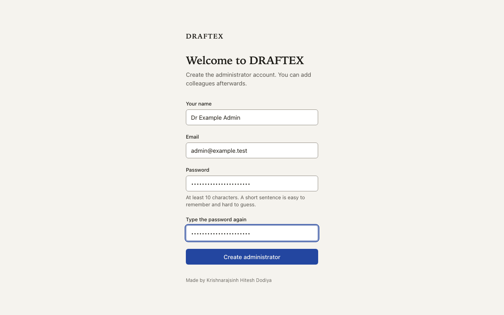

- Use a password of at least 10 characters. A short sentence is easy to
  remember and hard to guess.
- **Write the password down and keep it somewhere safe.** If it is
  forgotten, it can only be reset on the DRAFTEX computer itself
  (section 13). A second administrator account (section 11) is an easier
  spare key.

After that you see the home page:

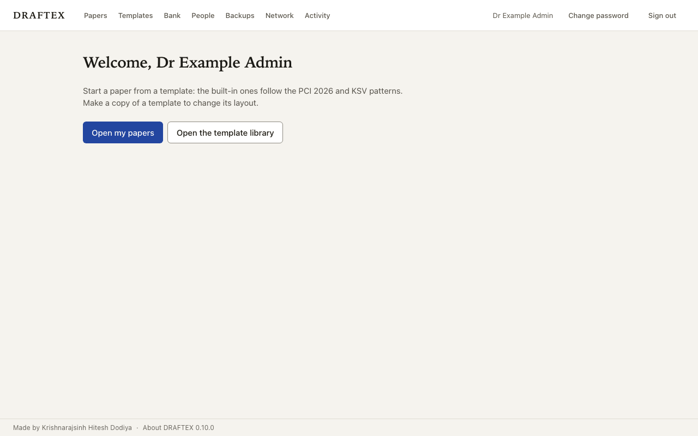

The top bar has **Papers**, **Templates**, and for the administrator
**People**, **Backups**, **Network** and **Activity**. Under the buttons,
**Recent papers** lists the five papers you changed last; click one to open
it.

---

## 4. Writing a paper

### Start from a template

A paper always starts from a template: the layout, groups and marks. The
built-in templates follow the PCI 2026 patterns and the KSV/KBIPER headers.

1. Click **Templates**.
2. Pick the one you need, for example *PCI 2026 · B.Pharm · Theory ·
   End-Semester · 4 credits*. Use the search box and filters to narrow the
   list.

   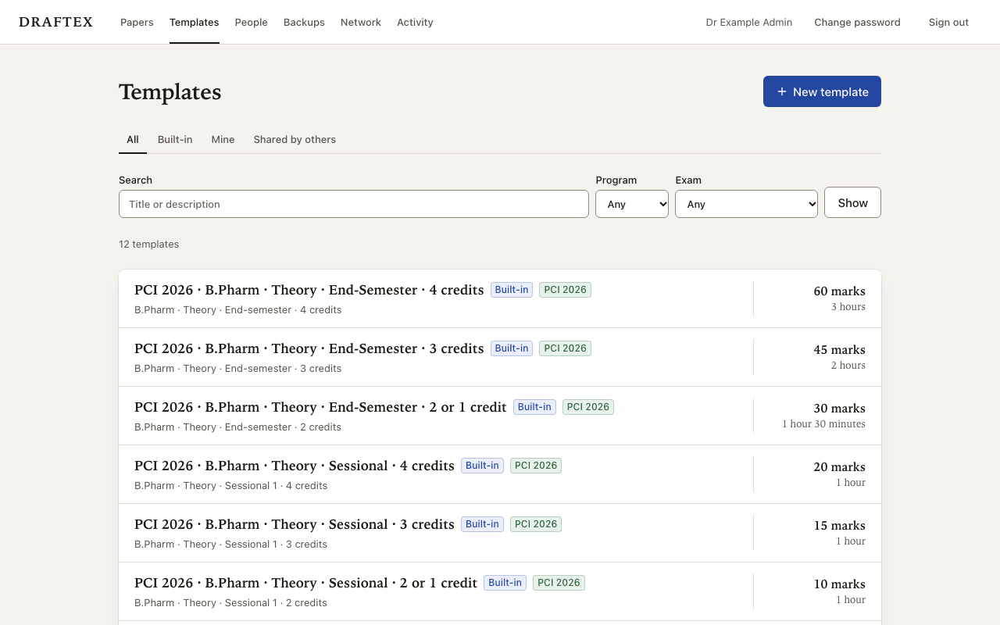

3. Click **New paper**. Give it a title, choose the **Course**, the **Exam
   date**, then **Create paper**. A course from the 2026 syllabus fills in
   its code, title and semester; change them if your paper differs (for
   example a course still on an older syllabus), or leave the course as
   "Not from the syllabus" and type them.

   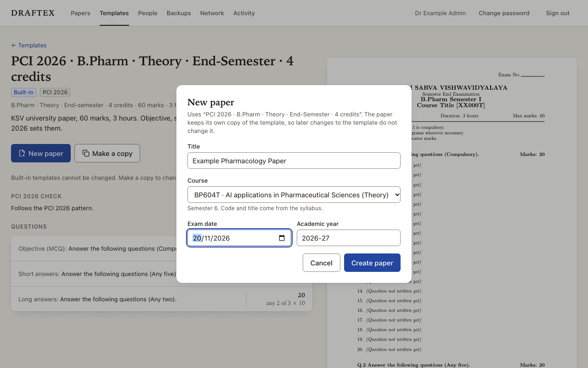

A template marked **Non-PCI** (for example the old KSV 75-mark paper for
ATKT students) works the same way; the badge only tells you it does not
follow the PCI 2026 pattern.

### The editor


- **Left:** every question place in the paper. Click a number to jump to it.
  The count ("2 of 30 questions written") and the marks total are at the top.
- **Middle:** the paper. Click **Click to write …** to write that question.
- **Right:** the PDF as it will print. It updates by itself a moment after
  you stop typing; **Recompile** does it now; **Download PDF** saves it.

While you write a question:

- **B**, *I*, U, x₂ and x² format the selected text.
- **Insert** adds an **Equation**, a **Table**, a **Picture** or
  **Choices (A–D)**. You can also type `/` and the first letters, for
  example `/choi` for choices.
- For an equation, type the maths as you would say it: `x^2`, `a/b`,
  `sqrt`, `alpha`. Press **Enter** when done.
- Pictures: PNG, JPG, PDF (one page) or SVG, up to 10 MB. Structures
  exported from CorelDRAW as PNG or PDF work well.
- **CO** and **Bloom** under each question set its course outcome tag and
  level. Type the CO tag, or pick one of the syllabus COs the field
  suggests. The CO tag prints at the right, like `[BP604T.01]`. Elective
  courses write the option after the number: `[BP607T.01 AEC1]`.
- **Sub-parts (a)(b)(c)** (Insert, or `/sub`) each have their own **Marks**,
  **CO** and **Bloom**. Left at "As question", a sub-part follows the
  question. DRAFTEX warns when the sub-part marks do not add up to the
  question's marks; the question's marks still count for the total.
- The small buttons move a question up or down, duplicate it, take a
  question from the bank or add it to the bank (section 8), or clear it.
  **Undo** at the top brings back a cleared, moved or inserted question.

**Advanced LaTeX** (Insert, only after an administrator allows it for you
under **People**) takes LaTeX typed by hand for things the buttons cannot
make. DRAFTEX checks it before it reaches the paper: commands that read or
write files, run programs or define new commands are refused, and the box
says why. It also offers these, and loads them for the paper by itself:

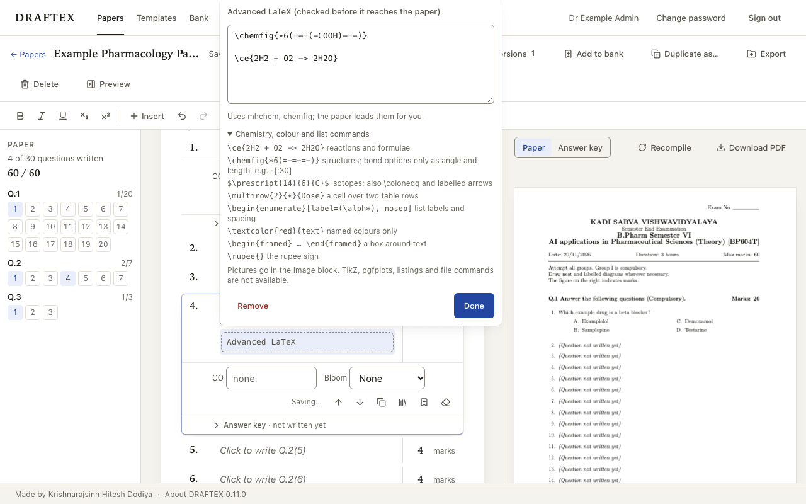

- `\ce{2H2 + O2 -> 2H2O}`: reactions and formulae.
- `\chemfig{*6(=-=-=-)}`: structures. A bond may say only its angle and
  length, such as `-[:30]` or `-[2,1.5]`; colours, styles and arrows
  between molecules are not offered.
- `$\prescript{14}{6}{C}$`, `\coloneqq` and labelled arrows such as
  `\xrightleftharpoons{k_1}`.
- `\multirow{2}{*}{Dose}` inside a table: one cell over two rows.
- `\begin{enumerate}[label=(\alph*), nosep]`: list labels and spacing.
- `\textcolor{red}{text}` with a named colour; `\begin{framed} … \end{framed}`
  for a box; `\rupee{}` for the ₹ sign (a ₹ typed as ordinary text still
  prints "Rs.").

Pictures, including structures drawn in CorelDRAW, go in the **Picture**
block. TikZ drawings, pgfplots graphs and program listings are not available;
for program code use a **Code block** (below). A size command such as
`\large` changes only its own Advanced LaTeX block; the question's marks and
the questions after it print at their normal size.

**Code block** (Insert, or `/code`) holds program code, such as Python for
a programming paper. Anyone can use it; it needs no permission.

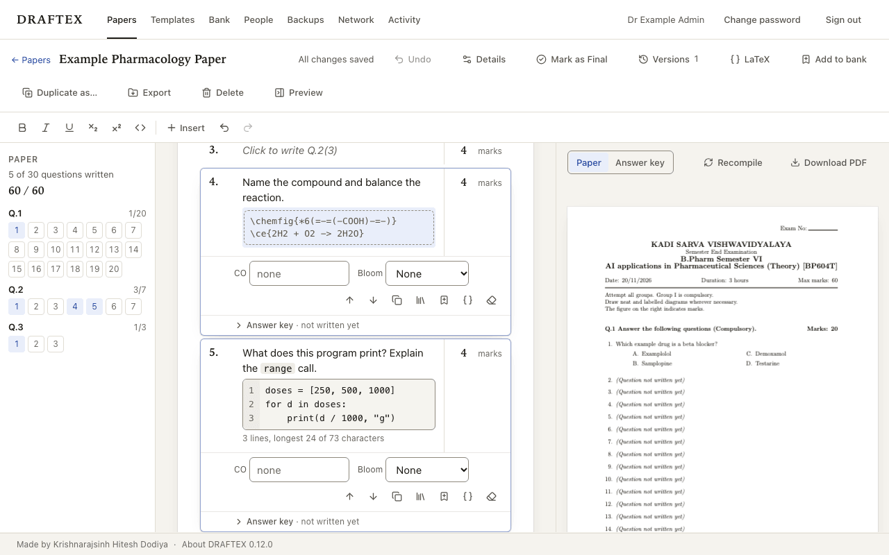

- Type or paste the code. Each line keeps its spaces, and the paper prints
  the lines numbered inside a frame, in a typewriter font. **Tab** indents
  by four spaces. To leave the block, press **Ctrl+Enter** (Mac: Cmd+Enter),
  press **Enter** three times at the end, or press the down arrow on its
  last line.
- The line under the block says how many characters fit on one line of this
  paper, for example "longest 22 of 73 characters"; the dashed line in the
  block shows where the frame ends. A longer line, or more than 40 lines,
  is marked in red until you shorten it, because LaTeX would let it run past
  the frame without any warning. Inside a sub-part a line fits a few
  characters fewer.
- Code is plain English keyboard characters (ASCII). Curly quotes, long
  dashes and non-breaking spaces copied from Word turn into straight quotes,
  hyphens and spaces by themselves, and the line under the block says so.
  Other characters, such as é or ₹, are refused.
- A line holding `\end{Verbatim}` is refused: it would end the code block.
- If a question starts with a code block, its number prints on a line of its
  own above the code.
- **Inline code** (the `<>` button, **Ctrl+E** (Mac: Cmd+E), or text between backticks
  such as `` `len` ``) prints a word or two of code inside a sentence in the
  same typewriter font.
- A model answer may hold a code block too, except for multiple-choice
  groups, whose key is one table.

**LaTeX** at the top of the paper, and the `{}` button under each question,
show the LaTeX DRAFTEX writes for the saved paper or question, with a
**Copy** button and a switch to the answer key. It is for reading and
copying only: change the question in the editor and the LaTeX follows.

"**All changes saved**" at the top means everything is stored. If DRAFTEX
finds a problem (for example a question that cannot be printed), the question
is marked and the message says what to change.

**Details** changes the title, course, exam date and academic year, and
has **Print Bloom levels**:

- When it is ticked, each question prints its level right after its text,
  like "(Bloom: Remember)", with the CO tag at the right as before. A
  question with sub-parts prints the level and CO on each sub-part line
  (a), (b), (c) instead, using the question's own where a sub-part has none.
- The answer key then shows the level too: a **Level** column for
  multiple-choice answers, and the level and CO after each question number.
- The switch belongs to this paper. A new paper starts with its template's
  setting (**Print the Bloom level after each question** in the template
  builder's Page section); copies such as ATKT papers keep it.

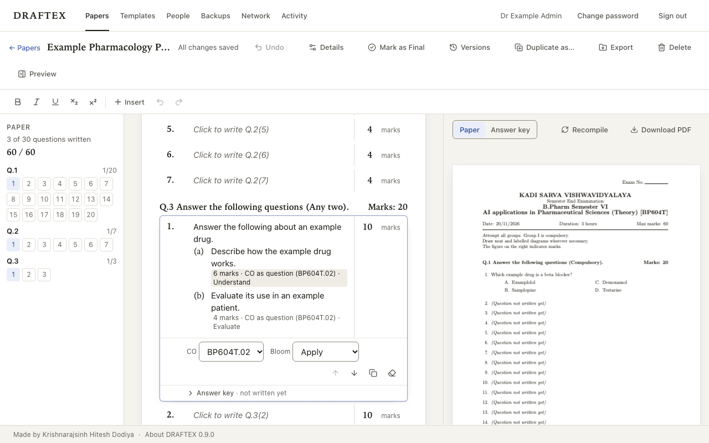

**Two COs.** Once a question (or sub-part) has a CO, a second CO box
appears next to it. Both print in one bracket, `[BP604T.01, BP604T.03]`.
Leave the second box empty when one CO is enough.

**Bloom and CO summary**, above the questions, counts the questions and
marks for each Bloom level and each CO. It counts every written question,
optional ones too, so the marks can add up to more than the paper's total.

**Tables.** Insert › **Table** adds a 3 × 3 table with a header row. While
the cursor is in a table, a **Table** bar appears under the toolbar.

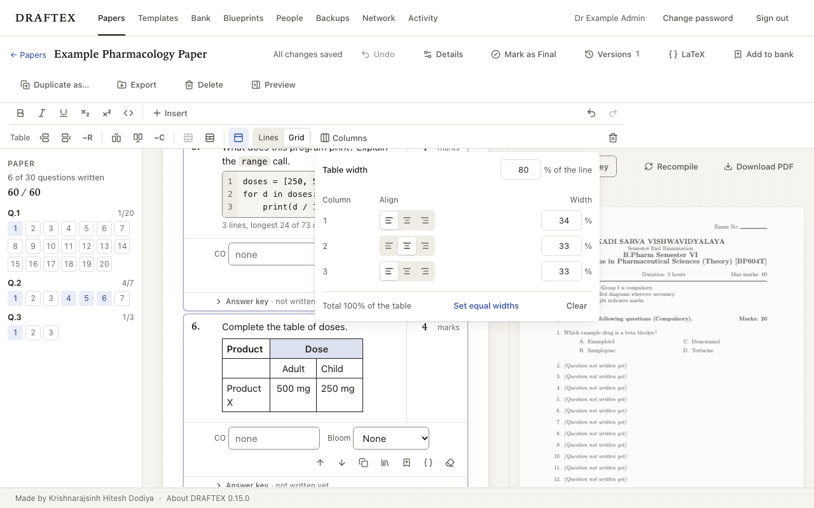

- Add or delete rows and columns with the first buttons. **Tab** moves to
  the next cell; in the last cell it adds a row.
- To merge cells, drag across them (or click one, then Shift+click
  another) and choose **Merge**. **Split** undoes it.
- **Lines** prints a rule above and below the table and under the header
  row, as on printed papers; **Grid** draws a line around every cell (the
  header row then prints in bold).
- **Columns** sets the table's width, each column's alignment (left,
  centre, right) and, if you want, each column's width in percent of the
  table. Widths must add up to 100%; **Set equal widths** does that for you.
- A table with any of these settings can have at most 10 columns and 30
  rows. A cell merged over several rows may hold as many lines as the rows
  it covers; if its text needs more, the question shows a note: shorten the
  text, widen the column or merge more rows. An equation in a cell cannot
  use `&` or `\\` outside a matrix.
- Tables made before this version print exactly as before until you change
  one of these settings. A table never breaks across two pages.

### Final and Printed papers

When a paper is finished, click **Mark as Final**. A Final paper is
read-only: a blue note at the top says so, and nothing in it can be changed
by accident, from this window or another one. **Exporting** a paper (section
6) marks it **Printed**, with the date.

To change a Final or Printed paper, click **Edit** in the note. DRAFTEX asks
first, then puts the paper back to **Draft**.

### Versions

Each time a paper is marked Final or exported, DRAFTEX keeps a copy of it as
it was then: a **version**. Click **Versions** in the paper to see them.

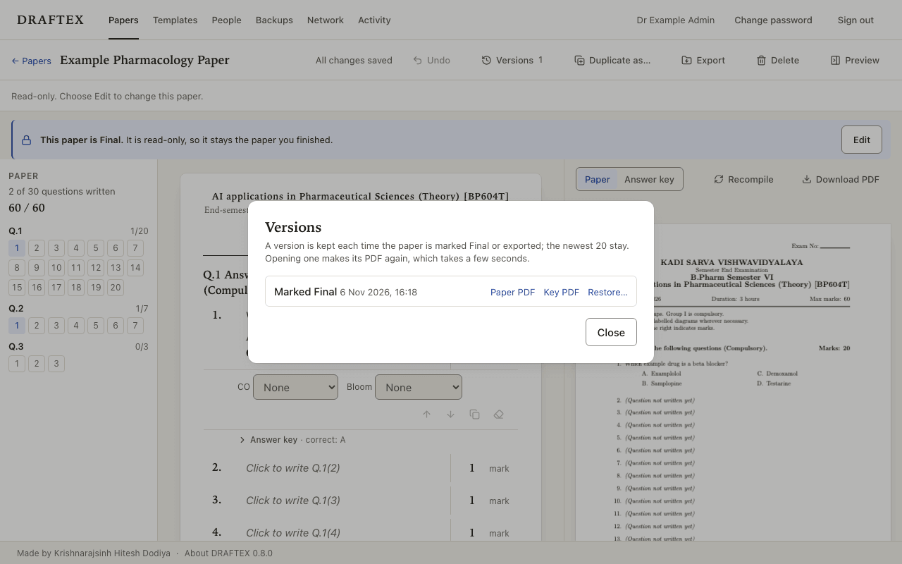

- **Paper PDF** and **Key PDF** show that version as it was printed. DRAFTEX
  makes the PDF again, which takes a few seconds.
- **Restore…** makes a new Draft paper from that version (with no exam
  date); the paper you are in stays as it is.

The newest 20 versions of each paper are kept. Versions are part of backups,
and they go to Trash and are deleted with their paper.

### Deleting a paper

Open the paper and click **Delete**, then **Move to Trash**. The Papers page
shows **Undo** straight away. Later, **Trash** on the Papers page lists your
deleted papers: **Restore** brings one back with all its questions and its
answer key; **Delete forever** removes it now. Papers left in Trash are
deleted for good after 30 days. Files you already exported stay in the
exports folder. Only you see your own Trash.

---

## 5. The answer key

Every question has an **Answer key** section under it.

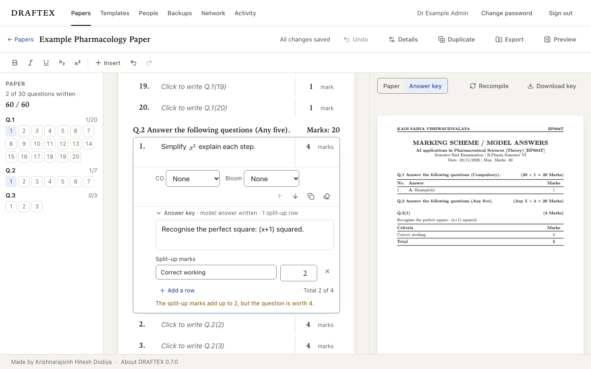

- For multiple-choice questions, tick the correct option. That is the key.
- For other questions, write the **model answer**, then **Add a row** for
  each part that earns marks ("Correct working", 2 marks). DRAFTEX warns
  when the split-up marks do not add up to the question's marks.
- Switch the preview on the right between **Paper** and **Answer key**.
  **Download key** saves the key PDF ("MARKING SCHEME / MODEL ANSWERS").

---

## 6. Exporting: the files you print or send

When the paper is ready, click **Export**.

If some questions are still empty or have no answer, DRAFTEX tells you first:

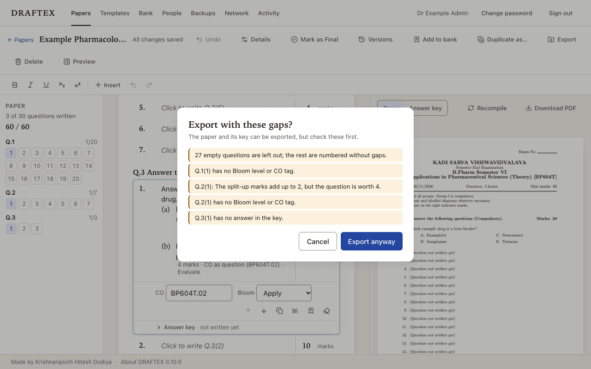

While **Print Bloom levels** is ticked, it also lists questions without a
Bloom level or CO tag; these do not stop the export.

Empty questions are left out and the rest are numbered without gaps. Click
**Export anyway**, or **Cancel** to finish them first. A paper with errors
cannot be exported until they are fixed.

The export is saved twice:

- as a **zip file** your browser downloads, and
- in the data folder, for example
  `DRAFTEX-data\exports\B.Pharm\BP604T\2026-11-20 Example Pharmacology Paper\`
  with `paper.pdf`, `key.pdf`, the LaTeX sources and pictures.

Exporting the same paper again on the same day replaces that day's folder.

A successful export marks the paper **Printed** and keeps a version of it
(section 4, "Versions").

---

## 7. Copies for ATKT and next year; finding papers

### Duplicate as…

Open the paper and click **Duplicate as…**, then choose:

- **Next academic year**: the same exam for the next year. DRAFTEX fills in
  the year (2026-27 becomes 2027-28); if your paper's year is written some
  other way, type the new one.
- **ATKT copy**: the supplementary (ATKT) version for the same year. This is
  the suggestion for an end-semester paper.
- **Another copy**: choose the exam yourself.

**Make the copy** copies the questions and the answer key into a new Draft
paper with no exam date; then change what you need. The paper you copied
stays as it is.

### Finding a paper

The **Papers** page lists your papers, the most recently changed first.

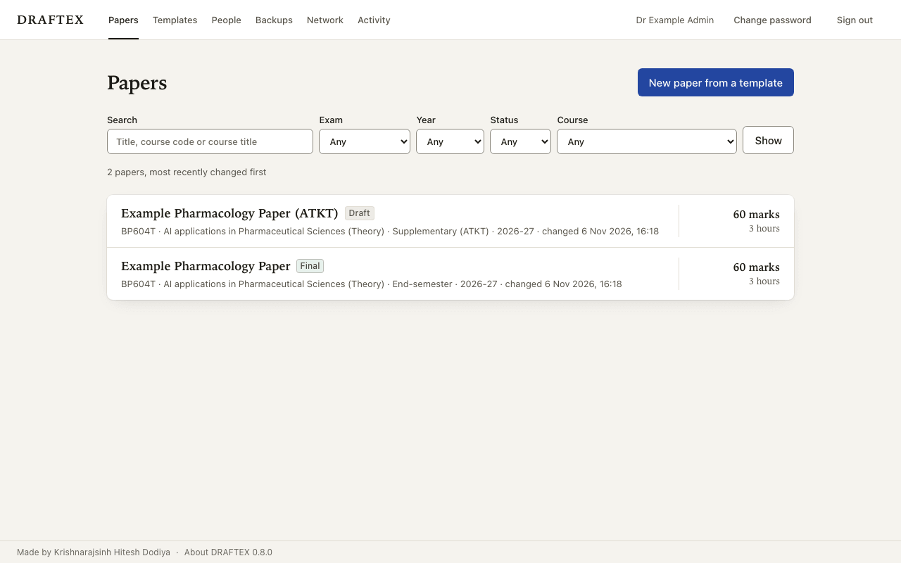

- Type in **Search** part of a title, a course code (BP604T) or a course
  title, and click **Show**.
- **Exam** narrows the list to Sessional, End-semester, ATKT, Practical or
  Other papers; **Year**, **Status** (Draft, Final, Printed) and **Course**
  offer what your own papers have.
- **Clear** shows every paper again. The browser's Back button returns to
  the list you had.

The search looks at titles and courses, not at the questions. Like
everything in DRAFTEX, it only ever shows your own papers.

---

## 8. The question bank

The **Bank** keeps questions you want to use again, with their course, unit,
CO, Bloom level, marks, type, answer and tags.

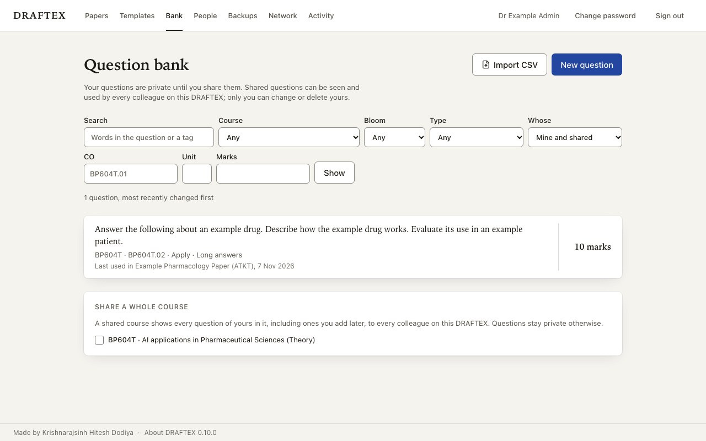

**Who sees what.** A question you add is **private**: nobody else sees it,
administrators included. To let colleagues use it, tick **Share with
colleagues** on the question, or share a whole course at the bottom of the
Bank page (every question of yours in that course, now and later). Shared
questions can be seen and used by everyone with an account on this DRAFTEX;
only you can change, delete or stop sharing yours. A colleague who wants to
change one uses **Copy to my bank** and edits the copy.

**Courses and COs.** Type the course code; for a course in the 2026 syllabus
DRAFTEX fills in its title and offers its COs and units as suggestions. You
can always type something else, for example for a course still on an older
syllabus, or an M.Pharm or Pharm.D course. A CO that the syllabus does not
list is saved with a note, never refused. Every question needs a **Bloom
level** and a **CO**.

### Adding questions

- **New question** on the Bank page: write it like a question in a paper
  (equations, tables, pictures, sub-parts), and its model answer.
- **From a paper:** click **Add to bank** at the top of the paper to add
  every question that has a Bloom level and a CO, or the bookmark button
  under one question to add just that one. DRAFTEX then lists what it added
  and what it skipped, and why (no Bloom level, no CO, already in your bank,
  the same as an earlier question on this paper).

  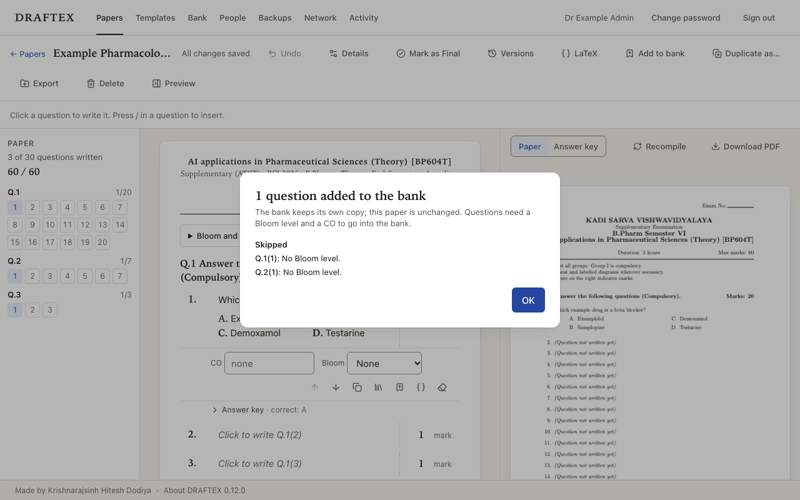

A question counts as already in your bank when its text is the same in the
same course, ignoring capitals, extra spaces and bold or italic. Writing one
by hand that is already there only gives a note.

### Using a bank question in a paper

Under a question place, click the **bank** button (the books). Pick a
question; the filters start with the paper's course and the place's marks.
"Last used in" shows the last of **your** papers that used it; nobody else
sees your uses.

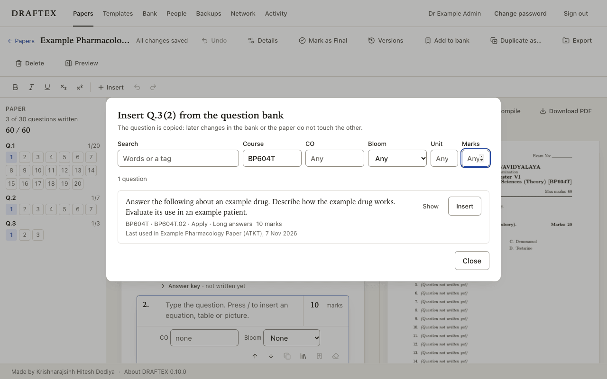

**Insert** copies the question, its CO, Bloom level and answer into the
place. The place keeps its own marks. The copy is separate: changing it in
the paper does not change the bank, and the other way round. **Undo** takes
an insert back.

### Importing from Excel (CSV)

1. On the Bank page click **Import CSV**, then download the **CSV template**.
2. Fill it in Excel, one question per row: course code, unit, CO (the full
   tag such as BP604T.01, or just its number), Bloom level, marks, type,
   question, answer and tags (separate tags with `;`). For multiple-choice
   questions fill **choice a** to **choice d** and **correct** (a, b, c or d).
3. Save it as **CSV UTF-8** (plain **CSV** also works), up to 1,000 questions
   and 1 MB per file.
4. Choose the file. DRAFTEX shows how it read the file (for example
   "Read as UTF-8") and checks every row: **Ready**, **Problem** with the
   reason, or **Duplicate**. Nothing is saved yet.

   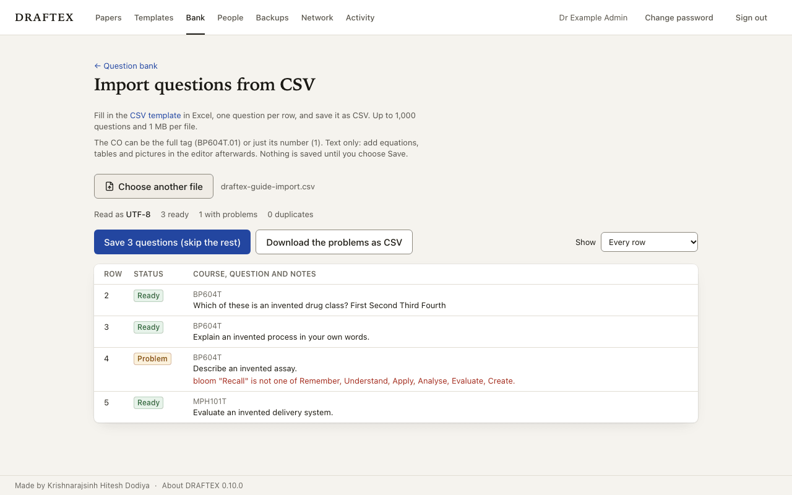

5. **Save** stores the ready rows and skips the rest. **Download the problems
   as CSV** gives you the rows that were not saved, with the reason, to fix
   and import again.

The import takes text only. Add equations, tables and pictures to a
question in the bank afterwards. Text such as `\input` or a cell starting
with `=` is stored as plain text, exactly as typed.

### Deleting a bank question

Open it and click **Move to Trash**. Bank questions share the Trash with
papers (Papers page, **Trash**) and are deleted for good after 30 days.
Papers that used the question keep their own copy.

---

### CO blueprints

A **CO blueprint** says how many marks (or what percent of the paper) each
CO should get, for one course and one kind of exam (Sessional,
End-semester, ATKT, Practical or Other). It is optional and only advises:
it never stops an export and prints nothing on the paper.

1. Open **Blueprints** at the top, then **New blueprint**.
2. Type the course code (suggestions come from the syllabus), choose the
   exam group, and choose **Marks** or **Percent of the paper**.
3. Set the **allowed difference**: a CO within this many marks (or percent)
   of its target counts as fine.
4. Add a row per CO with its target. **Fill from syllabus** adds every CO of
   a syllabus course. Percent targets must add up to 100.
5. **Save blueprint**. Tick **Share with colleagues** to let others use it;
   they cannot change it.

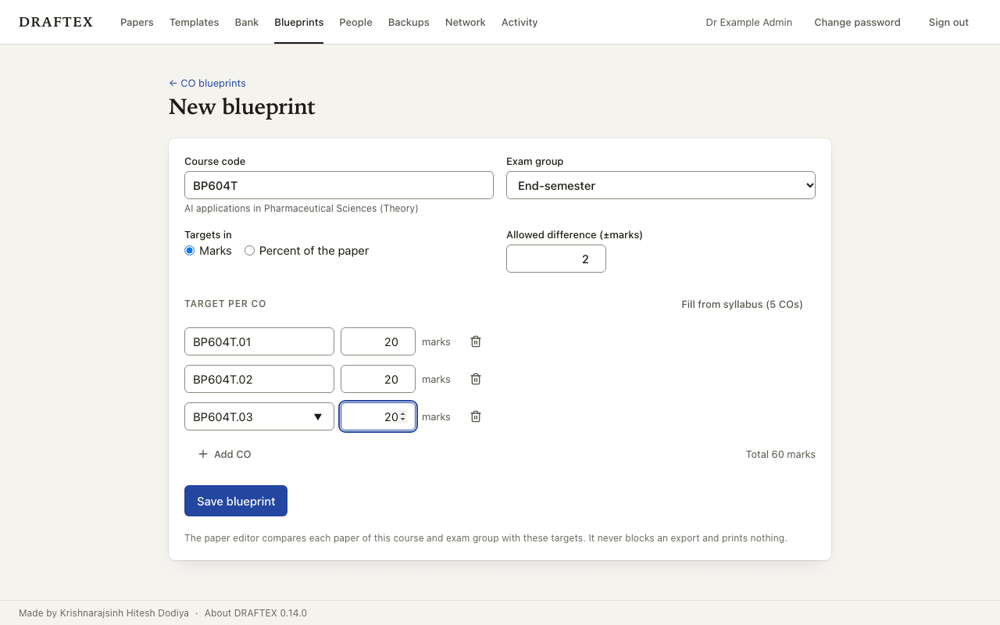

In the paper editor, **Bloom and CO summary** then shows each CO's target,
the paper's marks and **Under**, **Over** or **Within range**, and updates
as you type. The **Export** dialog lists the same notes; choose **Export
anyway** to go ahead.

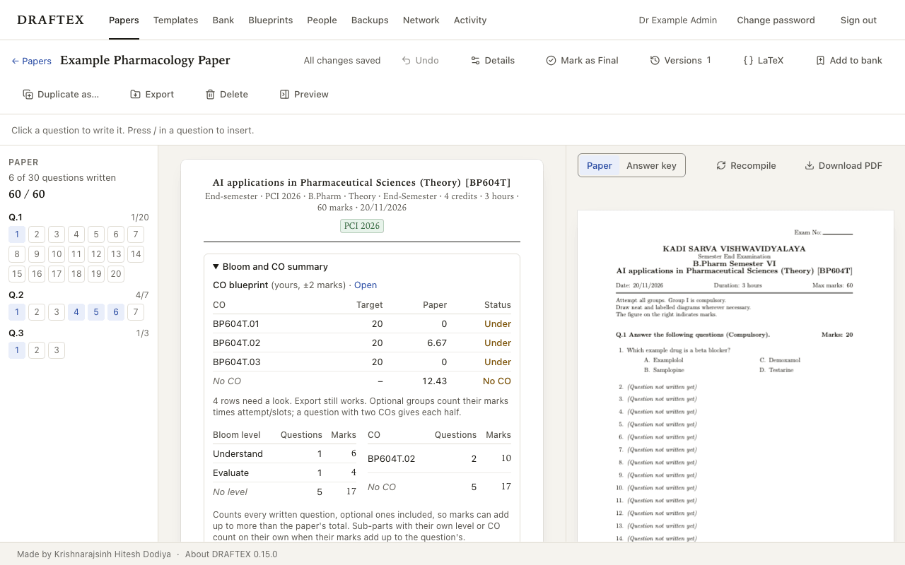

How marks are counted:

- A question with two COs gives each CO half its marks.
- Sub-parts with their own CO count on their own when their marks add up to
  the question's.
- In a group like "answer any 5 of 7", each question counts 5/7 of its
  marks, so the totals match what a student answers.
- Marks on questions with no CO are shown as **No CO**.

Your own blueprint is used first; if you have none, the most recently
changed one a colleague shared for the same course and exam group.

## 9. Templates

- **Built-in** templates cannot be changed. To change a layout, open one and
  click **Make a copy**: the copy is yours and opens in the template
  builder, with a live preview.
- **Deleting a template:** open it and click **Delete**. You can delete your
  own templates. An administrator can also delete a built-in one; it then
  disappears for everyone, and **Restore built-in templates** at the top of
  the Templates page brings all deleted built-ins back. The *Blank template*
  cannot be deleted, because **New template** starts from it.
- **New template** (on the Templates page) asks for a title and starts from a
  blank template.
- Your own templates are private until you make them **Global**; then
  colleagues can use and copy them, but only you can edit them.
- A paper keeps its own copy of its template, so changing or deleting a
  template later never changes a paper you already wrote.

---

## 10. Backups

*Administrator only.* Click **Backups**.


- DRAFTEX makes a backup **every day** by itself and keeps the newest 14.
  Updates also make one first.
- **Back up now** makes one immediately. Do this before a big change, and
  copy it to a pen drive now and then: a backup on the same computer does not
  help if the computer is lost or broken.
- **Download** saves a copy anywhere you like. **Delete** removes one.
- A backup is an ordinary zip file. It is **not encrypted** and contains
  every paper. Keep it private (section 1).

**To restore** (go back to a backup): choose the file under *Restore*, click
**Restore this backup…**, then **Check and restore**. DRAFTEX checks the
file, saves a backup of what is there now, and switches over when it
restarts (the screen offers **Restart now**). A restore brings back papers,
templates, pictures and accounts; this computer's network settings stay as
they are.

To restore onto a **new computer**, install DRAFTEX there (section 14), then
ask the person who installed it to run, in the DRAFTEX folder:

```
npm run restore -- "D:\DRAFTEX-backup-2026-11-04_101500-manual.zip"
```

---

## 11. Colleagues and other computers

### Adding colleagues

*Administrator only.* Click **People**.

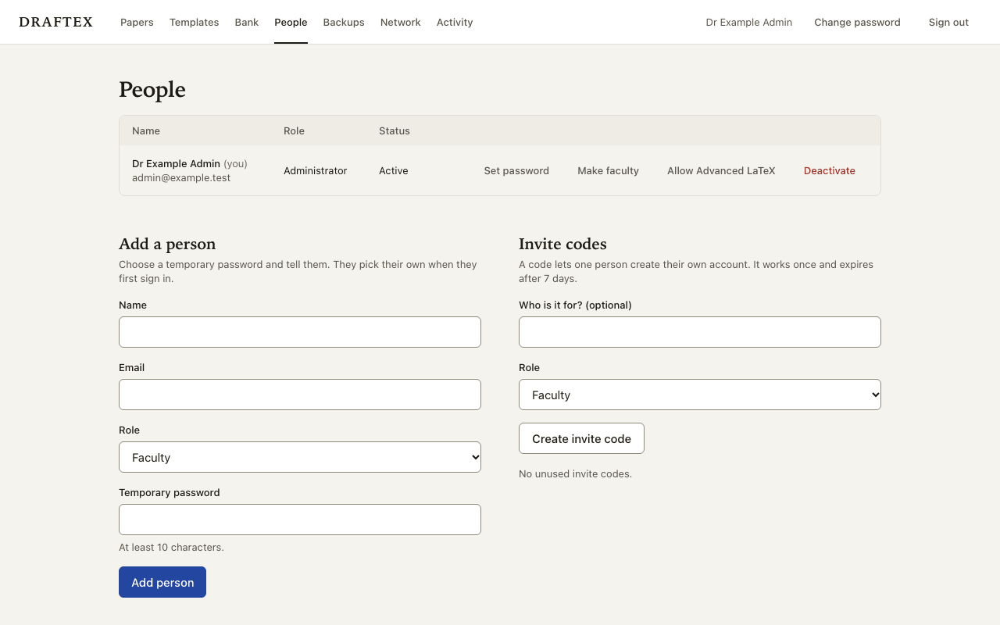

- **Add a person**: their name, email, role and a temporary password. Tell
  them the password; they choose their own at their first sign-in.
- **Invite codes**: a code lets one person create their own account. It
  works once and expires after 7 days.
- **Set password** gives someone a new temporary password if they forget
  theirs. **Make administrator** gives a trusted colleague the same powers
  as you (a good spare key). **Deactivate** stops an account without
  deleting its papers.
- Each person sees only their own papers and templates, plus templates
  someone made Global.

After 5 wrong passwords from one computer, that computer must wait 15
minutes before it can try that account again. Other computers are not
affected.

### Letting other computers in

*Administrator only.* By default only the computer DRAFTEX runs on can open
it. To let colleagues use it from their own computers on the staff network:

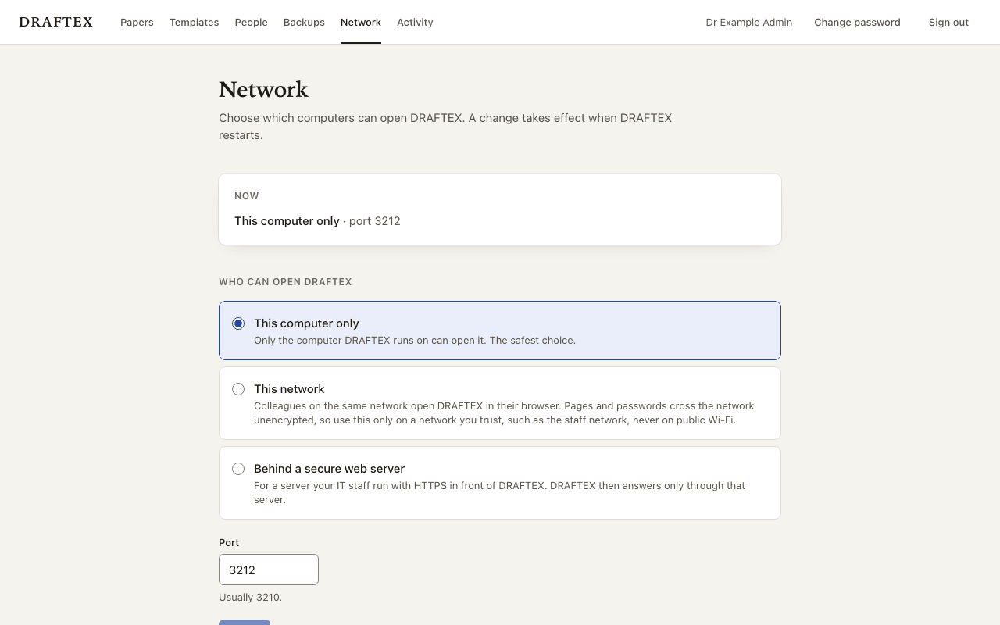

1. Click **Network**, choose **This network**, click **Save**.
2. Click **Restart now**.
3. On Windows, click **Allow other computers**. Windows asks for permission;
   click **Yes**. This lets computers on your private network (not the
   internet) reach DRAFTEX. **Stop allowing** removes it again.
4. Every page now shows a banner with the address colleagues type, such as
   `http://192.168.1.20:3210`.

The DRAFTEX computer must be switched on, with the black window open, while
colleagues use it.

**Behind a secure web server** is for a college server run by IT staff with
HTTPS. Do not choose it on a laptop: DRAFTEX then refuses direct access, even
from the same computer. If it was chosen by mistake, see section 13.

The **Activity** screen lists sign-ins, failed sign-ins, backups and
changes made by administrators.

---

## 12. Updating DRAFTEX

1. Close DRAFTEX (close the black window).
2. Open the DRAFTEX folder and double-click **update-windows.bat**
   (on a Mac: run `update-macos.sh`).
3. It checks DRAFTEX is closed, **makes a backup**, downloads the new
   version and installs it. This takes a few minutes. Press a key when it
   says so.
4. Start DRAFTEX as usual.

If the update stops, read its last lines: they say what to do. Your papers
are not touched by an update, and the backup it made is on the Backups
screen.

---

## 13. When something goes wrong

**The black window shows a message and DRAFTEX does not open.** Read the last
lines; they say what is wrong in plain words. The common ones:

| Message says | What to do |
|---|---|
| "Port 3210 is already in use. Another copy of DRAFTEX may be running" | DRAFTEX is probably already open: look for another black window, or restart the computer. |
| "DRAFTEX cannot find its data folder at …" | The data folder was moved or is on a drive that is not connected. Connect the drive, or see "Moving the data folder" below. |
| "DRAFTEX is not set up yet" | The person who installs DRAFTEX should run the setup again (section 14). |
| "The settings file … is not valid" | Ask the person who installs DRAFTEX; the fix is in `config.json` (below). |

**I chose "Behind a secure web server" and now nothing opens.**

1. Close the black window.
2. Open the data folder (`C:\Users\<your name>\DRAFTEX-data`) and open
   `config.json` with Notepad.
3. Change `"mode": "server"` to `"mode": "local"`. Save.
4. Start DRAFTEX again.

**The preview says the paper cannot be typeset.** The message points to the
question. Usually a symbol that cannot be printed (for example an emoji) or a
broken equation; change it and the preview comes back. The last good PDF
stays on screen meanwhile.

**I forgot my password.** Another administrator can give you a new temporary
password on **People** → **Set password**.

**I am the only administrator and forgot my password.** This works only on
the DRAFTEX computer itself:

1. Close DRAFTEX (close the black window).
2. Open the DRAFTEX folder (`C:\DRAFTEX`) and double-click
   **reset-password-windows.bat**. Type the account's email and press Enter.
   (On a Mac, in Terminal in the DRAFTEX folder:
   `.runtime/node/bin/node scripts/reset-password.ts you@example.com`.)
3. It shows a **temporary password** such as `k7mpq-x3vta-9hcer`. Write it
   down; it is shown only once.
4. Start DRAFTEX. The black window says "The password of … was reset".
5. Sign in with the temporary password; DRAFTEX asks you to choose a new one
   straight away.

If the window says no account has that email, check the spelling and repeat
from step 1. Anyone who can sit at the DRAFTEX computer can do this, which is
one more reason to lock the computer when you leave it.

**Moving the data folder** (for example to a bigger drive): close DRAFTEX,
then the person who installs DRAFTEX runs, in the DRAFTEX folder,
`npm run move-data -- "D:\DRAFTEX-data"`. DRAFTEX copies everything, checks
every file, and uses the new folder from then on. The old folder stays until
you delete it yourself, after checking your papers in the new place.

---

## 14. For the person who installs DRAFTEX

This part is for whoever sets DRAFTEX up (the developer). It is written for
Windows 10 or 11; the Mac steps follow.

### What you need

- A Windows 10 (version 1809 or newer) or Windows 11 computer, 64-bit.
- About 2 GB of free disk space and an internet connection for the setup
  (DRAFTEX works offline afterwards).
- A Windows account that is **not** inside OneDrive for the home folder
  (the usual case).

No administrator rights are needed: Node.js is unpacked into the DRAFTEX
folder and nothing is installed for the whole computer, except Git.

### Steps and time

Times measured on 2026-11-04 (see the table at the end).

1. **Install Git for Windows** from <https://git-scm.com/download/win>
   (defaults are fine; it includes Git Credential Manager). *About 3 min.*
2. **Make a read-only GitHub token** for this computer (D42). On
   github.com: *Settings → Developer settings → Personal access tokens →
   Fine-grained tokens → Generate new token*:
   - Repository access: *Only select repositories* → `DRAFTEX`.
   - Permissions: *Contents: Read-only* (nothing else).
   - Expiration: the longest you are comfortable with; note the date.

   Do not sign in to GitHub with your own account on this computer: that
   would leave a token here that can do everything your account can.
   *About 2 min.*
3. **Copy DRAFTEX** to the computer. Open *Command Prompt* and run:

   ```
   cd /d C:\
   git clone https://github.com/krishnarajsinhdodiya/DRAFTEX.git
   ```

   When Git Credential Manager asks, choose **Token** (or enter the username
   `krishnarajsinhdodiya` and paste the token as the password). It is saved
   in Windows Credential Manager for later updates. Keep the folder outside
   OneDrive, Desktop and Documents; `C:\DRAFTEX` is a good place.
   *About 1 min.*

   **Do not use GitHub's "Download ZIP"** instead. A ZIP copy has no link
   back to GitHub, so `update-windows.bat` can never update it, and it
   unpacks into Downloads with a doubled folder name
   (`Downloads\DRAFTEX-main\DRAFTEX-main`). Setup warns when it sees one.
4. **Run setup:** open `C:\DRAFTEX` and double-click **setup-windows.bat**.
   It downloads Node.js 24.22.2 and checks its fingerprint, installs the
   app's packages, prepares the database, downloads the LaTeX engine and its
   packages (the longest step), builds the app and puts **DRAFTEX** on the
   desktop. Running it again is safe. *See the table.*
5. **Start DRAFTEX** from the desktop and create the administrator account
   with its owner (section 3). *About 1 min.*
6. **Make a first backup** (Backups → Back up now) and check that a
   template preview appears. *About 1 min.*

**If setup stops while installing the app's packages** (messages such as
`ECONNRESET`, `ETIMEDOUT` or "network"): the internet connection dropped
during the large download. Setup already tries three times. Run
**setup-windows.bat** again; what was downloaded is kept, so it goes faster.
If it keeps failing, use another connection (a phone hotspot works), or
pause the antivirus's web or HTTPS protection until setup finishes; some
antivirus programs reset long downloads. `EPERM ... rmdir` lines printed
next to such an error are npm failing to tidy up after the dropped download
and can be ignored.

When the token expires, updates stop with "could not be downloaded". Make a
new token the same way and replace the old one in *Windows Credential
Manager → Windows Credentials → git:https://github.com*.

### On a Mac

Same order: Git comes with the Xcode command-line tools (`xcode-select
--install`), then `git clone` into a folder outside iCloud Drive, then in
Terminal:

```bash
cd ~/DRAFTEX
./setup-macos.sh
```

It puts **DRAFTEX.command** on the Desktop; double-click it to start. Update
with `./update-macos.sh`.

### Measured times

| Machine | Setup (step 4) | Notes |
|---|---|---|
| MacBook (Apple silicon), home broadband, clean folder | 5.0 min | Node.js download, `npm ci`, LaTeX engine and first package download (4.6 min), build |
| GitHub Actions `windows-latest`, clean checkout | 2.8 min | Node.js download 6 s; LaTeX packages came from the CI cache, so add about 4–5 min on a real first install |
| Update with no new packages | 0.4 min (Mac), 1.6 min (Windows CI) | backup, `git pull` (not in CI), `npm ci`, build |

The end user's laptop has not been timed yet; on a slower laptop or network
expect 10–15 minutes for step 4.

---

## 15. Uninstalling DRAFTEX

Uninstalling removes the program but **keeps your papers**, backups and
settings in the data folder (`C:\Users\<your name>\DRAFTEX-data`).

1. Close DRAFTEX (close the black window).
2. Open the DRAFTEX folder (`C:\DRAFTEX`) and double-click
   **uninstall-windows.bat**. (On a Mac: `./uninstall-macos.sh`.)
3. Answer **y** to uninstall. It removes the desktop shortcut and the
   program files. If other computers were allowed in (section 11), it offers
   to remove that Windows Firewall rule too; Windows asks for permission.
   It also asks whether to remove the saved GitHub sign-in used for updates.
4. When it says "DRAFTEX is uninstalled", close the window and delete the
   `C:\DRAFTEX` folder.

To use DRAFTEX again later, install it as in section 14: it finds the papers
in the data folder again.

**To remove the papers as well**, first make a backup (section 10) and copy it
somewhere safe if you may need the papers again, then delete the data folder
yourself. DRAFTEX never deletes it.

