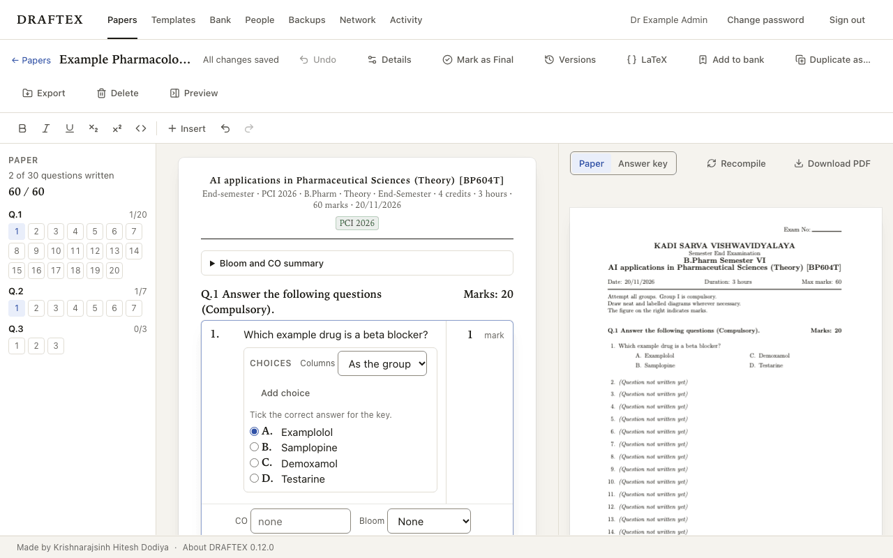
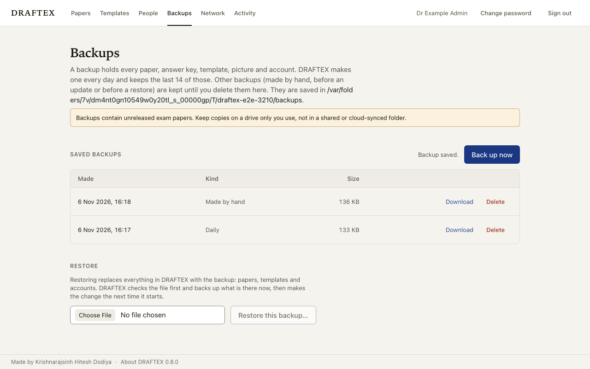

# DRAFTEX user guide

DRAFTEX helps you write question papers and their answer keys. You type the
questions; DRAFTEX lays them out in the KSV and KBIPER style, checks them
against the PCI 2026 B.Pharm pattern, and makes the PDF.

DRAFTEX runs on your own computer. Nothing goes to the internet. You use it in
your web browser (Chrome or Edge), but the papers stay on this computer.

The pictures in this guide use made-up names and questions.

---

## Contents

1. [Keep your papers safe (read this first)](#1-keep-your-papers-safe-read-this-first)
2. [Starting and closing DRAFTEX](#2-starting-and-closing-draftex)
3. [The first time: your administrator account](#3-the-first-time-your-administrator-account)
4. [Writing a paper](#4-writing-a-paper)
5. [The answer key](#5-the-answer-key)
6. [Exporting: the files you print or send](#6-exporting-the-files-you-print-or-send)
7. [An ATKT copy of a paper](#7-an-atkt-copy-of-a-paper)
8. [Templates](#8-templates)
9. [Backups](#9-backups)
10. [Colleagues and other computers](#10-colleagues-and-other-computers)
11. [Updating DRAFTEX](#11-updating-draftex)
12. [When something goes wrong](#12-when-something-goes-wrong)
13. [For the person who installs DRAFTEX](#13-for-the-person-who-installs-draftex)

---

## 1. Keep your papers safe (read this first)

DRAFTEX holds **unreleased exam papers**. Four rules keep them private:

- **Never open DRAFTEX to the internet.** Do not change your router, do not
  "forward ports", and do not let anyone set it up so it can be reached from
  outside the college. DRAFTEX is made for one computer, or at most the
  staff network you trust.
- **"This network" mode is not encrypted.** When colleagues use DRAFTEX from
  their own computers (section 10), what they type, including passwords and
  questions, crosses the network in plain form. Use it only on the staff
  network, never on public or hostel Wi-Fi.
- **Backups and exported papers contain the real papers.** Keep them on a
  pen drive or folder only you use. Do not put them in OneDrive, Google
  Drive, Dropbox, WhatsApp or e-mail until the exam is over.
- **Do not move the DRAFTEX folders into OneDrive or Google Drive.** Syncing
  can damage the database while DRAFTEX is running, and it would upload the
  papers.

Where things are kept (the **data folder**):

| Computer | Data folder |
|---|---|
| Windows | `C:\Users\<your name>\DRAFTEX-data` |
| Mac | `/Users/<your name>/DRAFTEX-data` |

Inside it: `exports` (your PDFs), `backups`, `assets` (pictures), and
`data.db` (the database). You can open `exports` and `backups` in File
Explorer at any time. Do not edit `data.db` or `config.json` unless this
guide tells you to.

---

## 2. Starting and closing DRAFTEX

**To start:** double-click **DRAFTEX** on the desktop.

A black window opens and, after a few seconds, your browser opens DRAFTEX at
`http://127.0.0.1:3210`. **Keep the black window open while you work.** You
can minimise it.

If you double-click DRAFTEX again while it is already running, it just opens
the browser again.

**To close:** close the black window (the ✕ at its top right). Everything you
typed is already saved: DRAFTEX saves each question a moment after you stop
typing.

If the browser tab was closed but DRAFTEX is still running, open
`http://127.0.0.1:3210` in the browser, or double-click DRAFTEX again.

---

## 3. The first time: your administrator account

The first time DRAFTEX starts, it asks you to create the **administrator**
account. The administrator can add colleagues, make backups and change the
network settings.


- Use a password of at least 10 characters. A short sentence is easy to
  remember and hard to guess.
- **Write the password down and keep it somewhere safe.** If it is
  forgotten, it can only be reset on the DRAFTEX computer itself
  (section 12). A second administrator account (section 10) is an easier
  spare key.

After that you see the home page:


The top bar has **Papers**, **Templates**, and for the administrator
**People**, **Backups**, **Network** and **Activity**.

---

## 4. Writing a paper

### Start from a template

A paper always starts from a template: the layout, groups and marks. The
built-in templates follow the PCI 2026 patterns and the KSV/KBIPER headers.

1. Click **Templates**.
2. Pick the one you need, for example *PCI 2026 · B.Pharm · Theory ·
   End-Semester · 4 credits*. Use the search box and filters to narrow the
   list.

   

3. Click **New paper**. Give it a title, choose the **Course** (code and
   title come from the syllabus), the **Exam date**, then **Create paper**.

   

A template marked **Non-PCI** (for example the old KSV 75-mark paper for
ATKT students) works the same way; the badge only tells you it does not
follow the PCI 2026 pattern.

### The editor



- **Left:** every question place in the paper. Click a number to jump to it.
  The count ("2 of 30 questions written") and the marks total are at the top.
- **Middle:** the paper. Click **Click to write …** to write that question.
- **Right:** the PDF as it will print. It updates by itself a moment after
  you stop typing; **Recompile** does it now; **Download PDF** saves it.

While you write a question:

- **B**, *I*, U, x₂ and x² format the selected text.
- **Insert** adds an **Equation**, a **Table**, a **Picture** or
  **Choices (A–D)**. You can also type `/` and the first letters, for
  example `/choi` for choices.
- For an equation, type the maths as you would say it: `x^2`, `a/b`,
  `sqrt`, `alpha`. Press **Enter** when done.
- Pictures: PNG, JPG, PDF (one page) or SVG, up to 10 MB. Structures
  exported from CorelDRAW as PNG or PDF work well.
- **CO** and **Bloom** under each question set its course outcome tag and
  level. The CO tag prints at the right, like `[BP604T.01]`.
- The small buttons move a question up or down, duplicate it or clear it.
  **Undo** at the top brings back a cleared or moved question.

"**All changes saved**" at the top means everything is stored. If DRAFTEX
finds a problem (for example a question that cannot be printed), the question
is marked and the message says what to change.

**Details** changes the title, course, exam date and status (Draft or
Final).

---

## 5. The answer key

Every question has an **Answer key** section under it.


- For multiple-choice questions, tick the correct option. That is the key.
- For other questions, write the **model answer**, then **Add a row** for
  each part that earns marks ("Correct working", 2 marks). DRAFTEX warns
  when the split-up marks do not add up to the question's marks.
- Switch the preview on the right between **Paper** and **Answer key**.
  **Download key** saves the key PDF ("MARKING SCHEME / MODEL ANSWERS").

---

## 6. Exporting: the files you print or send

When the paper is ready, click **Export**.

If some questions are still empty or have no answer, DRAFTEX tells you first:


Empty questions are left out and the rest are numbered without gaps. Click
**Export anyway**, or **Cancel** to finish them first. A paper with errors
cannot be exported until they are fixed.

The export is saved twice:

- as a **zip file** your browser downloads, and
- in the data folder, for example
  `DRAFTEX-data\exports\B.Pharm\BP604T\2026-11-20 Example Pharmacology Paper\`
  with `paper.pdf`, `key.pdf`, the LaTeX sources and pictures.

Exporting the same paper again on the same day replaces that day's folder.

---

## 7. An ATKT copy of a paper

Open the paper and click **Duplicate**. DRAFTEX suggests the exam
*Supplementary (ATKT)* and the title "… (ATKT)". **Make the copy** copies the
questions and the answer key; then change what you need.

---

## 8. Templates

- **Built-in** templates cannot be changed. To change a layout, open one and
  click **Make a copy**: the copy is yours and opens in the template
  builder, with a live preview.
- **New template** (on the Templates page) asks for a title and starts from a
  blank template.
- Your own templates are private until you make them **Global**; then
  colleagues can use and copy them, but only you can edit them.
- A paper keeps its own copy of its template, so changing or deleting a
  template later never changes a paper you already wrote.

---

## 9. Backups

*Administrator only.* Click **Backups**.



- DRAFTEX makes a backup **every day** by itself and keeps the newest 14.
  Updates also make one first.
- **Back up now** makes one immediately. Do this before a big change, and
  copy it to a pen drive now and then: a backup on the same computer does not
  help if the computer is lost or broken.
- **Download** saves a copy anywhere you like. **Delete** removes one.
- A backup is an ordinary zip file. It is **not encrypted** and contains
  every paper. Keep it private (section 1).

**To restore** (go back to a backup): choose the file under *Restore*, click
**Restore this backup…**, then **Check and restore**. DRAFTEX checks the
file, saves a backup of what is there now, and switches over when it
restarts (the screen offers **Restart now**). A restore brings back papers,
templates, pictures and accounts; this computer's network settings stay as
they are.

To restore onto a **new computer**, install DRAFTEX there (section 13), then
ask the person who installed it to run, in the DRAFTEX folder:

```
npm run restore -- "D:\DRAFTEX-backup-2026-11-04_101500-manual.zip"
```

---

## 10. Colleagues and other computers

### Adding colleagues

*Administrator only.* Click **People**.


- **Add a person**: their name, email, role and a temporary password. Tell
  them the password; they choose their own at their first sign-in.
- **Invite codes**: a code lets one person create their own account. It
  works once and expires after 7 days.
- **Set password** gives someone a new temporary password if they forget
  theirs. **Make administrator** gives a trusted colleague the same powers
  as you (a good spare key). **Deactivate** stops an account without
  deleting its papers.
- Each person sees only their own papers and templates, plus templates
  someone made Global.

After 5 wrong passwords from one computer, that computer must wait 15
minutes before it can try that account again. Other computers are not
affected.

### Letting other computers in

*Administrator only.* By default only the computer DRAFTEX runs on can open
it. To let colleagues use it from their own computers on the staff network:


1. Click **Network**, choose **This network**, click **Save**.
2. Click **Restart now**.
3. On Windows, click **Allow other computers**. Windows asks for permission;
   click **Yes**. This lets computers on your private network (not the
   internet) reach DRAFTEX. **Stop allowing** removes it again.
4. Every page now shows a banner with the address colleagues type, such as
   `http://192.168.1.20:3210`.

The DRAFTEX computer must be switched on, with the black window open, while
colleagues use it.

**Behind a secure web server** is for a college server run by IT staff with
HTTPS. Do not choose it on a laptop: DRAFTEX then refuses direct access, even
from the same computer. If it was chosen by mistake, see section 12.

The **Activity** screen lists sign-ins, failed sign-ins, backups and
changes made by administrators.

---

## 11. Updating DRAFTEX

1. Close DRAFTEX (close the black window).
2. Open the DRAFTEX folder and double-click **update-windows.bat**
   (on a Mac: run `update-macos.sh`).
3. It checks DRAFTEX is closed, **makes a backup**, downloads the new
   version and installs it. This takes a few minutes. Press a key when it
   says so.
4. Start DRAFTEX as usual.

If the update stops, read its last lines: they say what to do. Your papers
are not touched by an update, and the backup it made is on the Backups
screen.

---

## 12. When something goes wrong

**The black window shows a message and DRAFTEX does not open.** Read the last
lines; they say what is wrong in plain words. The common ones:

| Message says | What to do |
|---|---|
| "Port 3210 is already in use. Another copy of DRAFTEX may be running" | DRAFTEX is probably already open: look for another black window, or restart the computer. |
| "DRAFTEX cannot find its data folder at …" | The data folder was moved or is on a drive that is not connected. Connect the drive, or see "Moving the data folder" below. |
| "DRAFTEX is not set up yet" | The person who installs DRAFTEX should run the setup again (section 13). |
| "The settings file … is not valid" | Ask the person who installs DRAFTEX; the fix is in `config.json` (below). |

**I chose "Behind a secure web server" and now nothing opens.**

1. Close the black window.
2. Open the data folder (`C:\Users\<your name>\DRAFTEX-data`) and open
   `config.json` with Notepad.
3. Change `"mode": "server"` to `"mode": "local"`. Save.
4. Start DRAFTEX again.

**The preview says the paper cannot be typeset.** The message points to the
question. Usually a symbol that cannot be printed (for example an emoji) or a
broken equation; change it and the preview comes back. The last good PDF
stays on screen meanwhile.

**I forgot my password.** Another administrator can give you a new temporary
password on **People** → **Set password**.

**I am the only administrator and forgot my password.** This works only on
the DRAFTEX computer itself:

1. Close DRAFTEX (close the black window).
2. Open the DRAFTEX folder (`C:\DRAFTEX`) and double-click
   **reset-password-windows.bat**. Type the account's email and press Enter.
   (On a Mac, in Terminal in the DRAFTEX folder:
   `.runtime/node/bin/node scripts/reset-password.ts you@example.com`.)
3. It shows a **temporary password** such as `k7mpq-x3vta-9hcer`. Write it
   down; it is shown only once.
4. Start DRAFTEX. The black window says "The password of … was reset".
5. Sign in with the temporary password; DRAFTEX asks you to choose a new one
   straight away.

If the window says no account has that email, check the spelling and repeat
from step 1. Anyone who can sit at the DRAFTEX computer can do this, which is
one more reason to lock the computer when you leave it.

**Moving the data folder** (for example to a bigger drive): close DRAFTEX,
then the person who installs DRAFTEX runs, in the DRAFTEX folder,
`npm run move-data -- "D:\DRAFTEX-data"`. DRAFTEX copies everything, checks
every file, and uses the new folder from then on. The old folder stays until
you delete it yourself, after checking your papers in the new place.

---

## 13. For the person who installs DRAFTEX

This part is for whoever sets DRAFTEX up (the developer). It is written for
Windows 10 or 11; the Mac steps follow.

### What you need

- A Windows 10 (version 1809 or newer) or Windows 11 computer, 64-bit.
- About 2 GB of free disk space and an internet connection for the setup
  (DRAFTEX works offline afterwards).
- A Windows account that is **not** inside OneDrive for the home folder
  (the usual case).

No administrator rights are needed: Node.js is unpacked into the DRAFTEX
folder and nothing is installed for the whole computer, except Git.

### Steps and time

Times measured on 2026-11-04 (see the table at the end).

1. **Install Git for Windows** from <https://git-scm.com/download/win>
   (defaults are fine; it includes Git Credential Manager). *About 3 min.*
2. **Make a read-only GitHub token** for this computer (D42). On
   github.com: *Settings → Developer settings → Personal access tokens →
   Fine-grained tokens → Generate new token*:
   - Repository access: *Only select repositories* → `DRAFTEX`.
   - Permissions: *Contents: Read-only* (nothing else).
   - Expiration: the longest you are comfortable with; note the date.

   Do not sign in to GitHub with your own account on this computer: that
   would leave a token here that can do everything your account can.
   *About 2 min.*
3. **Copy DRAFTEX** to the computer. Open *Command Prompt* and run:

   ```
   cd /d C:\
   git clone https://github.com/krishnarajsinhdodiya/DRAFTEX.git
   ```

   When Git Credential Manager asks, choose **Token** (or enter the username
   `krishnarajsinhdodiya` and paste the token as the password). It is saved
   in Windows Credential Manager for later updates. Keep the folder outside
   OneDrive, Desktop and Documents; `C:\DRAFTEX` is a good place.
   *About 1 min.*

   **Do not use GitHub's "Download ZIP"** instead. A ZIP copy has no link
   back to GitHub, so `update-windows.bat` can never update it, and it
   unpacks into Downloads with a doubled folder name
   (`Downloads\DRAFTEX-main\DRAFTEX-main`). Setup warns when it sees one.
4. **Run setup:** open `C:\DRAFTEX` and double-click **setup-windows.bat**.
   It downloads Node.js 24.22.2 and checks its fingerprint, installs the
   app's packages, prepares the database, downloads the LaTeX engine and its
   packages (the longest step), builds the app and puts **DRAFTEX** on the
   desktop. Running it again is safe. *See the table.*
5. **Start DRAFTEX** from the desktop and create the administrator account
   with its owner (section 3). *About 1 min.*
6. **Make a first backup** (Backups → Back up now) and check that a
   template preview appears. *About 1 min.*

**If setup stops while installing the app's packages** (messages such as
`ECONNRESET`, `ETIMEDOUT` or "network"): the internet connection dropped
during the large download. Setup already tries three times. Run
**setup-windows.bat** again; what was downloaded is kept, so it goes faster.
If it keeps failing, use another connection (a phone hotspot works), or
pause the antivirus's web or HTTPS protection until setup finishes; some
antivirus programs reset long downloads. `EPERM ... rmdir` lines printed
next to such an error are npm failing to tidy up after the dropped download
and can be ignored.

When the token expires, updates stop with "could not be downloaded". Make a
new token the same way and replace the old one in *Windows Credential
Manager → Windows Credentials → git:https://github.com*.

### On a Mac

Same order: Git comes with the Xcode command-line tools (`xcode-select
--install`), then `git clone` into a folder outside iCloud Drive, then in
Terminal:

```bash
cd ~/DRAFTEX
./setup-macos.sh
```

It puts **DRAFTEX.command** on the Desktop; double-click it to start. Update
with `./update-macos.sh`.

### Measured times

| Machine | Setup (step 4) | Notes |
|---|---|---|
| MacBook (Apple silicon), home broadband, clean folder | 5.0 min | Node.js download, `npm ci`, LaTeX engine and first package download (4.6 min), build |
| GitHub Actions `windows-latest`, clean checkout | 2.8 min | Node.js download 6 s; LaTeX packages came from the CI cache, so add about 4–5 min on a real first install |
| Update with no new packages | 0.4 min (Mac), 1.6 min (Windows CI) | backup, `git pull` (not in CI), `npm ci`, build |

The end user's laptop has not been timed yet; on a slower laptop or network
expect 10–15 minutes for step 4.
